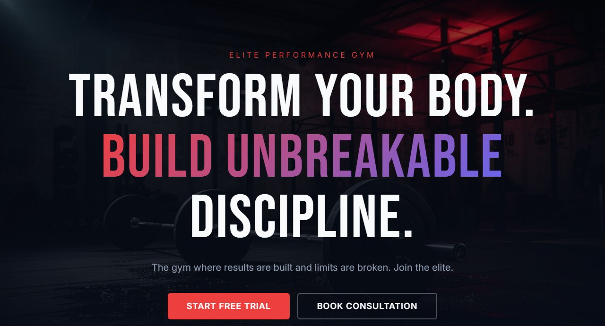
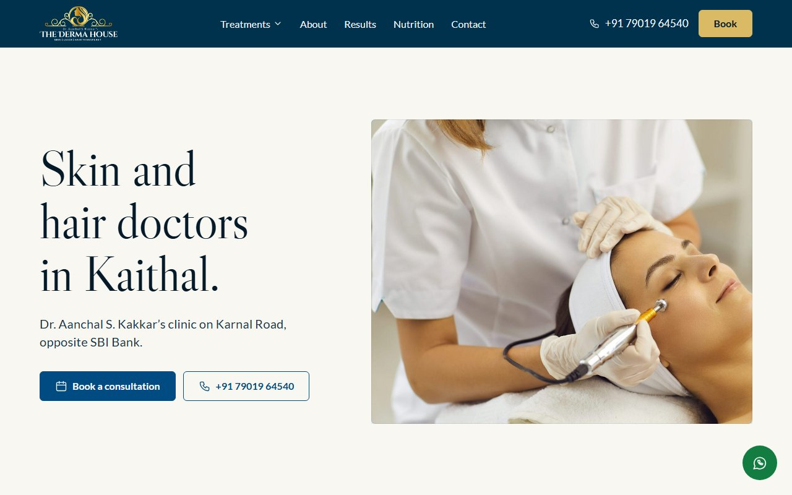

  

<h1 align="center">Gowigro</h1>

  Digital marketing &amp; web development agency. 
  Ready-to-launch website templates, customised with your brand and delivered to your own GitHub.

  
  

---

## 🛒 Website templates

<table>
  <tr>
    <td width="50%" valign="top">
      
      <h3>🏋️ Gym &amp; fitness template</h3>
      
A high-converting site for gyms, studios and personal trainers.

      <ul>
        <li>Hero, facilities, trainers, transformations, pricing, FAQ</li>
        <li>BMI calculator and lead-capture forms</li>
        <li>WhatsApp button and free-trial / consultation calls to action</li>
        <li>React, Vite, TypeScript, Tailwind CSS, shadcn/ui</li>
      </ul>
      

        <a href="https://gowigr0.github.io/gowigro-gym-template/"><b>▶ Live demo</b></a> ·
        <a href="https://github.com/gowigr0/gowigro-gym-template">Source</a> ·
        <a href="mailto:gowigro@gmail.com?subject=Gym%20website%20template"><b>Get this template</b></a>
      

    </td>
    <td width="50%" valign="top">
      
      <h3>🩺 Clinic &amp; healthcare template</h3>
      
A fast, SEO-ready site for clinics and medical practices.

      <ul>
        <li>62 pages: treatments, booking, results, nutrition, legal</li>
        <li>About 2.5 KB of JavaScript per page; static and very fast</li>
        <li>SEO redirects for moving from an old site</li>
        <li>Astro, deployable to any static host</li>
      </ul>
      

        <a href="https://gowigr0.github.io/gowigro-clinic-template/"><b>▶ Live demo</b></a> ·
        <a href="https://github.com/gowigr0/gowigro-clinic-template">Source</a> ·
        <a href="mailto:gowigro@gmail.com?subject=Clinic%20website%20template"><b>Get this template</b></a>
      

    </td>
  </tr>
</table>

### How it works

1. **Pick a template** and try the live demo.
2. **Contact us** with your business details: logo, colours, content.
3. **We customise it** with your brand and content.
4. **You own it**: the finished site is delivered to your own GitHub account and launched on your domain.

---

## 🧰 Services

[Web development](https://www.gowigro.com/services/web-development) ·
[SEO](https://www.gowigro.com/services/seo) ·
[Performance marketing](https://www.gowigro.com/services/performance-marketing) ·
[Social media marketing](https://www.gowigro.com/services/social-media-marketing) ·
[Branding](https://www.gowigro.com/services/branding) ·
[Content creation](https://www.gowigro.com/services/content-creation)

## 📬 Contact

- 🌐 [gowigro.com/contact](https://www.gowigro.com/contact)
- ✉️ [gowigro@gmail.com](mailto:gowigro@gmail.com)
- 💼 [LinkedIn](https://www.linkedin.com/company/g0wigr0/) · 📸 [Instagram](https://www.instagram.com/gowigro_/)
